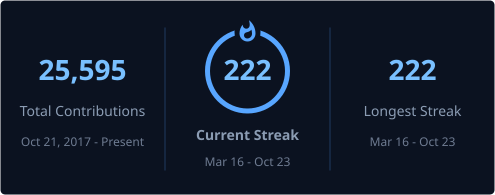

### Hi, I'm WisdomToNorth

Software engineer building local-first tools and shared workspace infrastructure
across C++, Qt/QML, Swift, Python, and mixed stacks.

<table>
  <tr>
    <td width="50%" valign="top">
      <h3><a href="https://github.com/NorthBoundWisdom/OcctQML">OcctQML</a></h3>
      Open CASCADE 3D viewer integrated into Qt Quick/QML applications.
    </td>
    <td width="50%" valign="top">
      <h3><a href="https://github.com/NorthBoundWisdom/GeoControls">GeoControls</a></h3>
      Reusable Qt/QML controls and application-shell components.
    </td>
  </tr>
  <tr>
    <td width="50%" valign="top">
      <h3><a href="https://github.com/NorthBoundWisdom/immivio">immivio</a></h3>
      Free, open-source VR video player for Meta Quest and PICO, with immersive playback and network media libraries.
    </td>
    <td width="50%" valign="top">
      <h3><a href="https://github.com/NorthBoundWisdom/sonafolio">SonaFolio</a></h3>
      Local-first podcast transcription and knowledge library for macOS, iOS, and Windows.
    </td>
  </tr>
</table>

  
  

